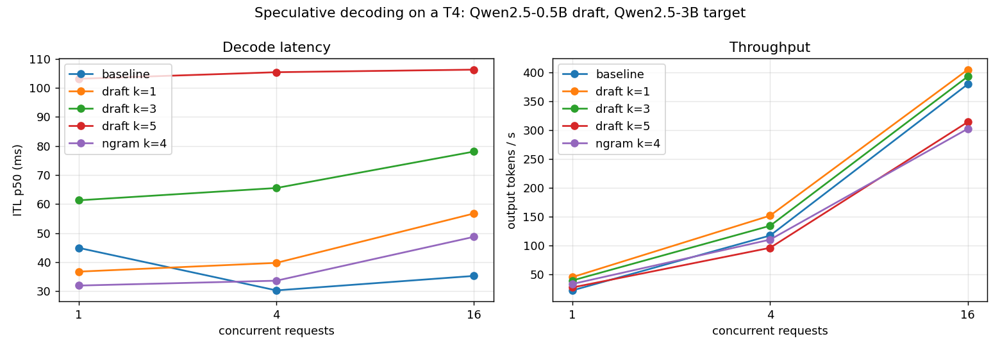

# specdec

Speculative decoding pipeline: small draft model plus large target, with per-request acceptance-rate tracking and measured speedup.

Project 6 of 15 in [inference-infra-portfolio](https://github.com/NomanJafar/inference-infra-portfolio).

## What this builds

A small draft model proposes tokens, a large target model verifies them; track acceptance rate and the resulting speedup per request.

## Why it matters

Faster decode with zero quality loss is the closest thing to a free lunch in inference.

## Status

Done. T4 results below; raw data in [`results/kaggle_run1/`](results/kaggle_run1/).

## What is in here

| Module | Purpose |
|---|---|
| `specdec.analysis` | Parses vLLM's `spec_decode_*` counters, computes acceptance rate / tokens-per-step / per-position rates from before-after deltas, the expected-tokens and speedup formulas from CONCEPTS.md, the `--speculative-config` argument, and the comparison table |
| `notebooks/kaggle_specdec.ipynb` | Baseline, draft-model speculation at k = 1, 3, 5 (Qwen2.5-0.5B → 3B), n-gram speculation; each at 1, 4, 16 users with the tokenbench sample prompts and natural stopping; greedy byte-identity check |

## Results (Tesla T4, vLLM 0.31.0, Qwen2.5-3B-Instruct FP16 target, Kaggle, 2026-10-11)

Sample-distribution prompts, natural stopping (`ignore_eos` off), up to 192 output tokens, 32–64 requests per cell. "ITL" here is the gap between streamed chunks; with speculation a chunk carries every token accepted in one verify step, so that column is the **step time**, and "out tok/s" is the real per-user (at concurrency 1) or aggregate token rate.

| config | concurrency | acceptance rate | tokens / step | ITL p50 | ITL speedup | out tok/s | throughput vs baseline |
|---|---|---|---|---|---|---|---|
| baseline | 1 | – | 1.00 | 44.9 ms | 1.00x | 22 | 1.00x |
| baseline | 4 | – | 1.00 | 30.3 ms | 1.00x | 117 | 1.00x |
| baseline | 16 | – | 1.00 | 35.3 ms | 1.00x | 379 | 1.00x |
| draft k=1 | 1 | 0.69 | 1.69 | 36.7 ms | 1.22x | 45 | 2.06x |
| draft k=1 | 4 | 0.69 | 1.69 | 39.8 ms | 0.76x | 151 | 1.30x |
| draft k=1 | 16 | 0.70 | 1.70 | 56.8 ms | 0.62x | 404 | 1.07x |
| draft k=3 | 1 | 0.50 | 2.50 | 61.3 ms | 0.73x | 39 | 1.79x |
| draft k=3 | 4 | 0.51 | 2.52 | 65.5 ms | 0.46x | 134 | 1.14x |
| draft k=3 | 16 | 0.51 | 2.53 | 78.1 ms | 0.45x | 392 | 1.04x |
| draft k=5 | 1 | 0.38 | 2.89 | 103.1 ms | 0.44x | 27 | 1.23x |
| draft k=5 | 4 | 0.38 | 2.89 | 105.4 ms | 0.29x | 95 | 0.82x |
| draft k=5 | 16 | 0.39 | 2.94 | 106.3 ms | 0.33x | 314 | 0.83x |
| ngram k=4 | 1 | 0.22 | 1.88 | 32.0 ms | 1.41x | 33 | 1.51x |
| ngram k=4 | 4 | 0.21 | 1.82 | 33.6 ms | 0.90x | 110 | 0.94x |
| ngram k=4 | 16 | 0.22 | 1.87 | 48.7 ms | 0.72x | 302 | 0.80x |



**Greedy outputs identical to baseline, all configurations: yes** (3 prompts x 160 tokens each, `results/kaggle_run1/identity_check.json`).

**Per-position acceptance** (fraction of drafts accepted at position 1, 2, ...): k=3: 0.67, 0.48, 0.35; k=5: 0.65, 0.46, 0.33, 0.25, 0.20; n-gram k=4: 0.44, 0.23, 0.12, 0.09.

**KV cache after loading**: baseline 175,008 tokens; with the draft model 110–120k; n-gram 158k.

### What the numbers say

1. **Lossless, verified.** Five configurations, byte-identical greedy outputs. The acceptance rule does what the proof says; the cost shows up only in time and memory.
2. **The per-position decay is the geometric model from the primer.** Position-1 acceptance is 0.65–0.69 everywhere (the draft agrees with the target about two thirds of the time on this text); the later positions fall as α^n with α ≈ 0.68 (predicted 0.68, 0.46, 0.32; measured 0.67, 0.48, 0.35). Tokens per step therefore saturate: 1.69 → 2.50 → 2.89 for k = 1, 3, 5, while the drafting cost grows linearly.
3. **k = 1 is the best setting for this pair on this GPU, and the gain is modest: +30% throughput at 4 users, +7% at 16.** Step time at k = 1 is 1.2x the baseline step (one 0.5B draft pass plus verification), so 1.69 tokens per step buys ~1.3x. At k = 3 the step costs 2.0x for 2.5 tokens (≈1.1x); at k = 5, 3.4x for 2.9 tokens (a net loss, 0.82x). The primer's draft-cost estimate of 0.2 per draft token held at k = 1 and rose with k, since the verify pass also grows with k and vLLM caps `max_num_scheduled_tokens` at 2048 under speculation (it warns about this at startup).
4. **The crossover is where the primer said it would be.** Gains shrink from 4 to 16 users (1.30x → 1.07x for k = 1) as decode becomes compute-bound and rejected drafts turn into wasted FLOPs; at 16 users, k = 5 and n-gram are 17–20% *slower* than the baseline. On a T4 with a 3B model, speculation belongs to the low-concurrency regime only.
5. **N-gram speculation is nearly free and nearly useless on this text.** It proposed drafts in only ~7% of steps (317 drafts over ~4,700 generated tokens) with 0.22 acceptance: chat answers to varied questions rarely repeat their prompt. It would look different on summarisation or extraction (CONCEPTS.md section 8), which this run did not include.
6. **Speculation costs memory.** Loading the 0.5B draft and its cache, and the larger verification batch, cut the KV cache from 175k to 110k tokens (−37%): a third less concurrency headroom, on top of the compute argument against it at high batch.
7. **One row is not trustworthy, and it is the one that would look best.** The baseline at 1 user measured 44.9 ms per token, slower than the same server at 4 users (30.3 ms), which cannot be right in steady state; it was the first measurement after start, and 2 warm-up requests were not enough to get past CUDA-graph capture and compilation for new shapes. Taken at face value it would show k = 1 at 2.06x; against the 4-user baseline the honest single-user figure is about 1.3x. Future runs warm up for 30 s before the first level.

### What was not measured

A text set where n-gram speculation should win (summarisation, extraction); temperatures above 0 (acceptance falls with sampling); larger k with `disable_by_batch_size`-style adaptive settings; EAGLE/Medusa heads.

## Layout

```
CONCEPTS.md     the theory behind the project, written before the code
src/specdec/   implementation
tests/          CPU-only tests, runnable on a laptop
notebooks/      GPU notebooks (Kaggle / Colab) that run the experiments and write results/
results/        measured numbers and plots
```

## Running

```bash
python -m venv .venv && source .venv/bin/activate
pip install -e ".[dev]"
pytest
```

GPU experiments run from `notebooks/`; each notebook clones this repo, installs it and writes its outputs to `results/`.

## Hardware notes

Developed against free-tier GPUs (Kaggle and Colab T4, 16 GB). Where a T4 limits what can be measured (no FP8, Turing-era kernels), the README says so rather than papering over it.

## License

MIT
